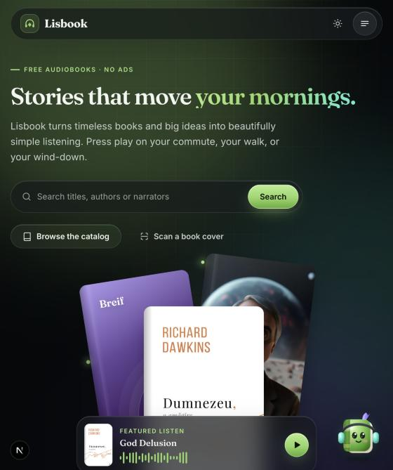
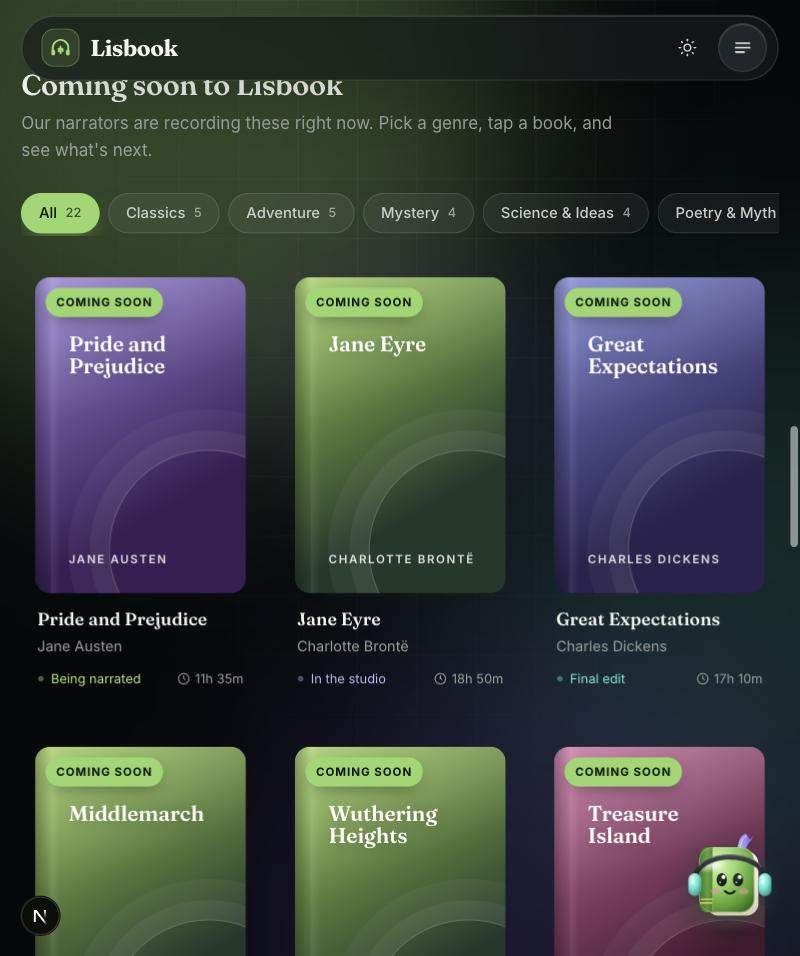
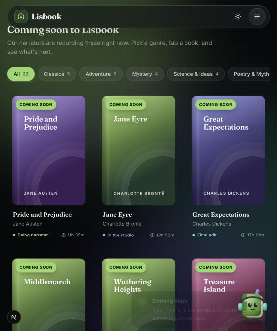

# 🎧 LisBook - A Simple Audio Book Player

<div align="center">


[](https://github.com/Ctoic/Lisbook/stargazers)
[](https://github.com/Ctoic/Lisbook/network)
[](https://github.com/Ctoic/Lisbook/issues)
[](https://github.com/Ctoic/Lisbook/blob/main/LICENSE)

*Immerse yourself in the world of audiobooks with simplicity and elegance* ✨

</div>

---

## 📖 Description

LisBook is a **beautifully crafted audiobook player** designed for book lovers who value simplicity and functionality. Transform your reading experience by listening to your favorite books in MP3 format with our intuitive and feature-rich player.

> 🌟 **"Reading is dreaming with open eyes"** - LisBook makes that dream even more accessible!

### ✨ Key Features:

<table>
<tr>
<td width="50%">

🎮 **Playback Controls**
- ▶️ **Play/Pause**: Seamless audio control
- ⏹️ **Stop**: Reset and restart anytime
- ⏭️ **Chapter Navigation**: Skip between chapters effortlessly

</td>
<td width="50%">

⚙️ **Customization**
- 🚀 **Speed Control**: Listen at your perfect pace
- 🔊 **Volume Adjustment**: Perfect audio levels
- 🎨 **Theme Options**: Personalize your experience

</td>
</tr>
</table>

LisBook is all about **simplicity and convenience**, making your audiobook journey smooth, customizable, and absolutely delightful! 🌈

---

## 📱 Screenshots

<div align="center">


*Experience the clean and intuitive interface of LisBook*

</div>

---

## 🏠 Interactive Homepage

The new web app homepage (`apps/web`) is built to feel alive: things move, react to your cursor, and invite you to explore.

<div align="center">





*Hero · Coming-soon shelf · "Coming soon" toast*

</div>

### ✨ What's new

<table>
<tr>
<td width="50%">

🎬 **Animations**
- 🌀 **Hero entrance**: headline, search and buttons rise in one after another
- 🔤 **Rotating headline**: "Stories that move *with you / your mind / your mornings / the world*"
- 📚 **Floating cover stack** that drifts with your mouse (parallax), plus a glowing halo and sparkles
- 🔢 **Count-up stats** when the library numbers scroll into view
- 🪄 **Scroll reveal** for every section, with staggered tiles and steps

</td>
<td width="50%">

📖 **Coming-soon books**
- 🗂️ **22 placeholder audiobooks** across Classics, Adventure, Mystery, Science & Ideas and Poetry & Myth
- 🏷️ **Genre tabs** that swap shelves with a staggered card animation
- 🎴 **3D tilt cards** with a cursor-following glare, a "Coming soon" ribbon and a pulsing status (*In the studio*, *Being narrated*, *Final edit*)
- 🎞️ **Endless cover marquee**: two rows scrolling in opposite directions, paused on hover
- 🔔 **Click any upcoming book** to get a "Coming soon" toast telling you it will be added shortly

</td>
</tr>
</table>

♿ Respects `prefers-reduced-motion`: visitors who turn off motion get a calm, fully visible page.

### 🛠️ Tools & tech used

| Tool | How it's used |
| --- | --- |
| **Next.js 15 (App Router)** | Server-rendered homepage, with small client components for interactivity |
| **React 19 + TypeScript** | `RevealObserver`, `CountUp`, `ParallaxStage`, `RotatingWord`, `UpcomingShelves`, `ComingSoonCard`, `CoverMarquee` |
| **Plain CSS** (Lisbook glass design system) | Keyframe animations, 3D `perspective` tilt, mask-faded marquee; no animation library added |
| **Browser APIs** | `IntersectionObserver` (scroll reveal, count-up), Pointer Events + `requestAnimationFrame` (parallax and tilt) |
| **Existing toast provider** | Shows the "Coming soon" notification |
| **Claude Code** | Built the feature and checked it in the in-app browser preview (screenshots above) |

### 📁 Where the code lives

- `apps/web/app/page.tsx`: homepage layout
- `apps/web/components/home/motion.tsx`: reveal, count-up, parallax and rotating-word helpers
- `apps/web/components/home/coming-soon.tsx`: shelves, tilt cards and cover marquee
- `apps/web/lib/upcoming-books.ts`: the placeholder book list (edit this to change the upcoming titles)
- `apps/web/app/globals.css`: the "Home motion & coming-soon shelves" section

```bash
npm run dev:web
```

---

## 🎃 Hacktoberfest Contribution Guide

<div align="center">

### 🎉 **Join the LisBook Community!** 🎉
*We're excited to be part of Hacktoberfest and would love your contributions!*

</div>

### 🚀 Ways to Contribute:

| 🐛 **Bug Fixes** | 🎨 **UI Improvements** | ✨ **New Features** | 📱 **Mobile Responsive** | 📚 **Documentation** |
|---|---|---|---|---|
| Spot and squash bugs | Enhance design & UX | Implement cool features | Improve device compatibility | Clarify and improve docs |

### 🔧 Quick Start Guide:

```bash
# 1. Fork this repository (click the Fork button above! ⭐)

# 2. Clone your fork
git clone https://github.com/YOUR_USERNAME/Lisbook.git
cd Lisbook

# 3. Create a new branch
git checkout -b feature/your-amazing-feature

# 4. Make your changes
# ... code, code, code ... 💻

# 5. Commit and push
git add .
git commit -m "✨ Add amazing feature"
git push origin feature/your-amazing-feature

# 6. Open a Pull Request
# Go to the original repo and click "New Pull Request" 🚀
```

### 🎯 Hacktoberfest Tips:

- ✅ Follow the [Hacktoberfest Guidelines](https://hacktoberfest.com/participation)
- 🤝 Be respectful and patient during reviews
- 💡 Check existing issues for contribution ideas
- 🎨 Feel free to suggest improvements!

## 📄 License

This project is licensed under the **MIT License** - see the [LICENSE](LICENSE) file for details.

---

## 👨‍💻 Author Info

<div align="center">

**Created with ❤️ by Najam Ali Abbas**

[](https://twitter.com/Ct0ic)
[](https://github.com/ctoic)
[](https://www.linkedin.com/in/ct0ic/)

*Let's connect and build amazing things together!* 🤝

</div>

---

<div align="center">

### 🎯 **Ready to start your audiobook journey?** 

**[⭐ Star this repository](https://github.com/Ctoic/Lisbook)** • **[🍴 Fork and contribute](https://github.com/Ctoic/Lisbook/fork)** • **[📖 Try LisBook now!](#-lisbook---a-simple-audio-book-player)**

*Made with 💜 for the love of books and technology*

</div>
